 

---

## About me

I'm **Yogesh Chavan**, a full-stack developer building software under **[ShivYog Infotech](https://shivyoginfotech.com/)**.
I turn day-to-day business work into software people actually use: ERP systems, attendance and payroll,
billing and inventory, Windows desktop apps and company websites. I take a project from the first
screen to a secure, monitored production server, and keep it running after launch.

- 🏭 Building the **Saaksha & Kinni ERP**: accounts, production, dispatch, job-worker payments and attendance in one system
- 🖥️ Shipping a **Windows desktop app** for it that installs and updates itself
- ☁️ Running everything on **AWS** with push-to-deploy from GitHub
- 🎮 Making **LearnQuest**, a 3D runner game where children learn while they play

---

## Featured work

<table>
<tr>
<td width="50%" valign="top">

### 🏭 Saaksha & Kinni ERP
Private · in daily use

A complete business system for the Saaksha & Kinni team.

- **Modules:** Accounts, Production, Dispatch, Job-worker payments, Attendance & Payroll
- **Command Center:** users, roles and page permissions, activity timeline, security log, error center, backups, system health
- **Desktop app:** Electron app for Windows with computer identity, animated navigation and one-click self-updates; the installer is built on the server from GitHub
- **Deployment:** GitHub webhook → AWS with signature check, PHP lint, a quiet-moment wait, a short maintenance screen and rollback copies
- **Up to date:** PHP 8.5, MySQL 8.4 LTS, Bootstrap 5.3, jQuery 4

`PHP` `MySQL` `JavaScript` `Bootstrap` `Electron` `AWS` `Ubuntu`

</td>
<td width="50%" valign="top">

### 🎮 [LearnQuest – Jungle Run](https://github.com/yogesh0159/learnquest-v2)
Public

A parent-and-child learning platform built around a 3D endless-runner game.

- **3D runner** in Three.js: lanes, jumps, slides, power-ups and boss levels
- **Learning gates** with Maths, English and GK questions by age group
- **Two worlds, 20 levels:** Jungle World and Maths Kingdom
- **Progress:** XP, coins, streaks, reward shop and parent dashboard
- **English, Hindi and Marathi**
- **Web app** with Android, iPhone and desktop shells

`JavaScript` `Three.js` `Node.js` `Express` `MySQL` `SQLite`

</td>
</tr>
<tr>
<td width="50%" valign="top">

### 🛠️ ShivYog Infotech platform
Private · [shivyoginfotech.com](https://shivyoginfotech.com/)

The company website and service platform in one.

- Admin panel, customer portal and technician portal
- Repair tickets, inventory and billing
- MySQL database, deployed on AWS EC2

`PHP` `MySQL` `JavaScript` `AWS EC2`

</td>
<td width="50%" valign="top">

### 📱 [Shri Ji Mobiles & Electronics](https://github.com/yogesh0159/shriji-mobiles-website)
Public

The official website of a mobile and electronics store.

- Mobile-first pages for mobiles, electronics, about and contact
- SEO basics: sitemap and robots.txt
- Deployed on Netlify

`HTML` `CSS` `JavaScript` `Netlify`

</td>
</tr>
</table>

---

## Tech stack

**Frontend** 

**Backend & databases** 

**Desktop, cloud & tools** 

---

## How I work

| | |
|---|---|
| 🎯 **Start from the real work** | Software is built around how the business already works, not the other way round. |
| 🧪 **Test before release** | Every change is checked on desktop and mobile before it reaches the live server. |
| 🔐 **Secure by default** | Roles and permissions, audit logs, protected files and no secrets in the code. |
| 🚀 **Ship without downtime** | Push to GitHub and the server updates itself, with a way back if something goes wrong. |
| 🔧 **Stay after launch** | Monitoring, backups and regular upgrades keep systems fast and safe. |

---

## Contribution activity

<picture>
  <source media="(prefers-color-scheme: dark)" srcset="https://raw.githubusercontent.com/yogesh0159/yogesh0159/output/github-contribution-grid-snake-dark.svg" />
  <source media="(prefers-color-scheme: light)" srcset="https://raw.githubusercontent.com/yogesh0159/yogesh0159/output/github-contribution-grid-snake.svg" />
  
</picture>

---

### Let's build something useful

Need an ERP, a business app or a website? Get in touch through **[shivyoginfotech.com](https://shivyoginfotech.com/)**.

Code · Ideas · Solutions · Better tomorrow

